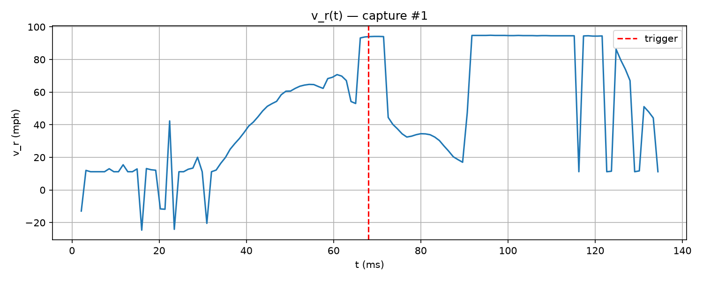
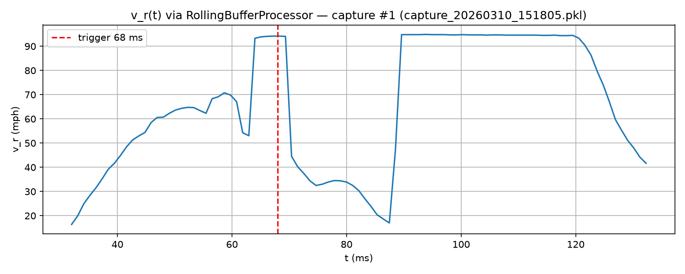
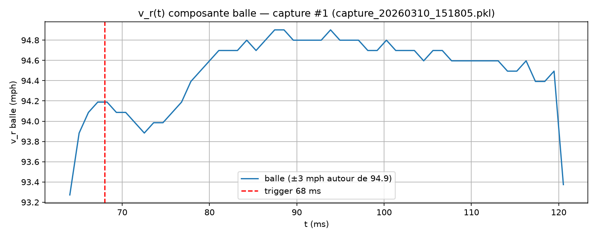
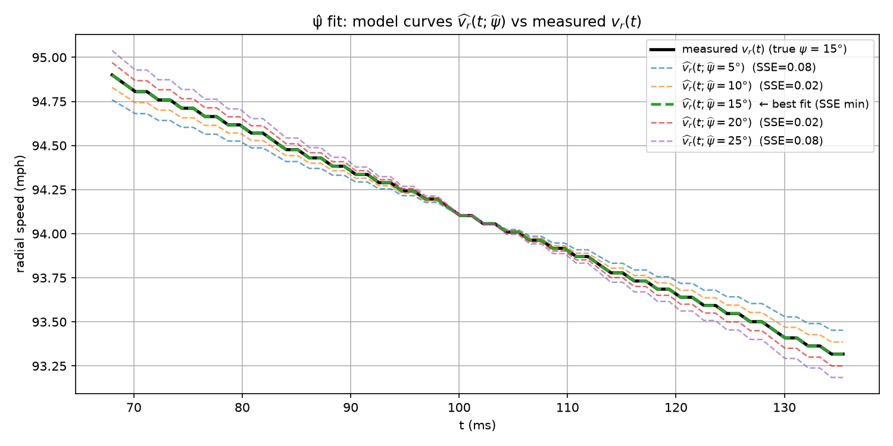

# Launch-angle contribution — porting notes

> Translated from my personal notes (`SimulateurGolf/OpenFlightReflexion.md`), section
> "Portage de la contribution launch angle" through the v_r(t) extraction tests.

## Porting decision

- **Target = OPS243** (24.125 GHz, 30 kHz, 4096-sample rolling I/Q buffer), not my 10.5 GHz radars
- The ψ-fit algorithm is **independent of f_c**: it works on v_r(t) in m/s; f_D = 2·v_r·f_c/c only scales
- What changes: source = `SpeedTimeline` from `RollingBufferProcessor` (already exists) instead of WAV; post-impact window **136 ms** (vs 350 ms on my setup) → ψ grid to adjust
- Frequencies: 10.525 GHz → 70 Hz per m/s; 24.125 GHz → 161 Hz per m/s (×2.3 resolution)

## Computing elevation ψ — two methods

1. **K-LD7 vertical (openflight hardware)**: bearing from phase interferometry (2 antennas / 1 LO) + geometry (`kld7/geometry.py`): 2 post-impact frames + vBall + distance + mount tilt → ψ
2. **OPS243 alone (Doppler fit, my method to port)**:
   - extract v_r(t): sliding STFT → Doppler peak → v_r in m/s
   - model: integrate 2D flight (drag + gravity + Magnus) → V_model(t) → v_r_model = c·V_model·cos(ψ)
   - ψ grid ∈ [2°, 30°], min SSE, conf = 1 − SSE/SST

## Effect of azimuthal drift on v_r(t)

- Full relation: `v_r(t) = V(t)·cos(ψ−ε)·cos(α(t))`
- Curvature (side spin) slightly reduces measured v_r (cos α < 1) → potential bias on ψ if uncorrected
- Over 136 ms (OPS243): negligible (α ≈ 2–3°, cos α ≈ 0.999, error < 0.1 %)
- Correction possible if α(t) is known (stereo f_Δ or horizontal K-LD7): `v_r_corr = v_r_meas / cos(α(t))`
- On long captures (WAV 350 ms+) the effect stays small but measurable

## K-LD7 replaceability

| openflight element | possible replacement |
|---|---|
| K-LD7 horizontal (azimuth) | my 2× 10.5 GHz radars (horizontal baseline, f_Δ) |
| K-LD7 vertical (elevation ψ) | Doppler fit on OPS243 (software) — NOT by my 2 radars (horizontal baseline = azimuth, not elevation) |

## 3D trajectory display on the Raspberry (kiosk) — contribution #5

- openflight already serves a **React kiosk UI** on the Pi (`scripts/start-kiosk.sh`), but 100 % 2D (`ShotDisplay`, `ShotList`, `StatsView`) — no 3D component
- `src/openflight/ballistics.py:simulate()` already produces `Trajectory.points` (t,x,y,z in yards), but only `carry_yards` is sent over the WebSocket (`src/openflight/server.py:1923`)
- My `trajectoire_capture_3d.html` (three.js) does exactly that 3D rendering
- **Plan**: (1) `server.py` includes `trajectory.points` in the "shot" payload; (2) new `ui/src/components/Trajectory3D.tsx` (three.js); (3) fullscreen on the kiosk after each shot

## v_r(t) extraction test — validated

- Script: `scripts/extract_vr.py` (clone Documents/James-openflight)
- Source: `session_logs/capture_20260310_151805.pkl`, capture #1 (fs=30 kHz)
- Chain: raw ADC I/Q counts → centering → `s = I + jQ` → STFT (window 128, hop 32, FFT zero-padded 4096, DC mask ±5 m/s) → peak f_D → `v_r = f_D·c/(2·f_c)`
- **Result: peak v_r = 94.9 mph at t=96 ms = ball_speed_mph metadata** ✓
- Curve: club ramp-up 10→70 mph, jump to ~95 mph at trigger (68 ms), then decay
- Next step: ballistic ψ fit on this v_r(t) curve

**Raw v_r(t) trace — capture #1, source file `session_logs/capture_20260310_151805.pkl` (fs=30 kHz, trigger at 68 ms, peak 94.9 mph = ball_speed_mph):**

**v_r(t) via the official reader `src/openflight/rolling_buffer/processor.py:RollingBufferProcessor.process_overlapping()` (CFAR, `IQCapture` from `types.py`) — same capture #1: no more negative spikes, peak 94.9 mph at t=93.9 ms:**

- Script: `scripts/extract_vr_official.py` — builds an `IQCapture` from the `.pkl` and calls the repo's official processor

**Ball-only v_r(t) via the official extractor `src/openflight/rolling_buffer/processor.py:RollingBufferProcessor.process_capture()` (with `_find_consistent_ball_speed()`, `find_club_speed()`, `BALL_SPEED_MATCH_TOLERANCE_MPH`) — capture #1, `session_logs/capture_20260310_151805.pkl`: ball=94.9 mph, club=63.6 mph, smash=1.49 (== pkl metadata); script `scripts/extract_ball_official.py`:**

> Note: over 136 ms the ball only loses ~1.5 mph (decay barely visible at the end of the window) → the ψ fit on this window alone is weakly constrained; the long WAV captures (350 ms+) from my own project give a much better v_r(t) curvature.

## Full equation chain: from I/Q to $\widehat{\psi}$

$$s(t) = \bigl(I(t) - \overline{I}\bigr) + j\,\bigl(Q(t) - \overline{Q}\bigr) \tag{1}$$

$$S(t_n, f) = \mathrm{FFT}\bigl[\,w(m)\,s(t_n+m)\,\bigr] \tag{2}$$

$$f_D(t_n) = \arg\max_f \lvert S(t_n,f)\rvert \tag{3}$$

$$v_r(t_n) = f_D(t_n)\,\frac{c}{2 f_c} \tag{4}$$

$$t_n \ge t_{impact} \;\text{and}\; \lvert v_r(t_n) - v_{Ball}\rvert \le 3\ \text{mph} \tag{5}$$

$$\widehat{v_r}(t;\widehat{\psi}) = \widehat{c}\,\widehat{V}(t;\widehat{\psi})\cos\widehat{\psi} \tag{6}$$

$$\widehat{c} = \frac{\sum \widehat{v_r}\,v_r}{\sum \widehat{v_r}^{\,2}} \tag{7}$$

$$\mathrm{SSE}(\widehat{\psi}) = \sum_n \Bigl(v_r(t_n) - \widehat{v_r}(t_n;\widehat{\psi})\Bigr)^2 \tag{8}$$

$$\widehat{\psi}^{*} = \arg\min_{\widehat{\psi}} \mathrm{SSE}(\widehat{\psi}), \qquad \mathrm{conf} = 1 - \frac{\mathrm{SSE}(\widehat{\psi}^{*})}{\mathrm{SST}} \tag{9}$$

Expanded (without SSE), with $\widehat{c}$ replaced by its least-squares value (7):

$$\widehat{\psi}^{*} = \arg\min_{\widehat{\psi}} \sum_n \Bigl( v_r(t_n) - \widehat{V}(t_n;\widehat{\psi})\cos\widehat{\psi} \cdot \frac{\sum_m \widehat{V}(t_m;\widehat{\psi})\cos\widehat{\psi}\; v_r(t_m)}{\sum_m \bigl(\widehat{V}(t_m;\widehat{\psi})\cos\widehat{\psi}\bigr)^2} \Bigr)^2 \tag{10}$$

> **(11)** In Python, the $\arg\min$ of (10) is computed with `numpy.argmin` over the vector of SSE values on the grid: `idx = np.argmin(sse_vector)` then `psi_hat = psi_grid[idx]` (see `src/openflight/launch_angle.py:estimate_launch_angle()`).

> **Why the lateral component is neglected in the $\widehat{\psi}$ fit**: the full relation is $v_r = V\cos(\psi-\varepsilon)\cos(\alpha)$. Over 136 ms the azimuthal drift stays $\alpha \approx 2{-}3°$, so $\cos(\alpha) \approx 0.999$ → error < 0.1 % on $v_r$, negligible for the targeted accuracy. Hence the 2D (vertical plane) fit is sufficient here.

**Didactic plot — measured $v_r(t)$ (black) vs model curves $\widehat{v_r}(t;\widehat{\psi})$ for several $\widehat{\psi}$ (synthetic data, true $\psi=15°$, `scripts/analysis/plot_psi_fit.py`): the best fit is $\widehat{\psi}=15°$ (min SSE, green curve on the black measured curve):**

### Variable index

| Symbol | Meaning |
|---|---|
| $I(t), Q(t)$ | raw 12-bit ADC counts, In-phase / Quadrature channels |
| $\overline{I}, \overline{Q}$ | mean (DC offset) of each channel |
| $s(t)$ | reconstructed complex signal $I + jQ$ |
| $w(m)$ | Hann window, $N = 128$ samples |
| $S(t_n, f)$ | STFT spectrum at time $t_n$ (spectrogram) |
| $f_D$ | Doppler frequency shift |
| $f_c$ | carrier frequency = 24.125 GHz |
| $c$ | speed of light = 299 792 458 m/s |
| $v_r(t)$ | **measured radial velocity** (projection on radar line of sight) |
| $v_{Ball}$ | detected ball speed (mode-based, `process_capture`) |
| $t_{impact}$ | impact time |
| $\widehat{v_r}(t)$ | **model-predicted** radial velocity |
| $\widehat{V}(t)$ | model-predicted true ball speed (2D flight model) |
| $\widehat{\psi}$ | **estimated launch angle** (elevation) |
| $\widehat{\psi}^{*}$ | retained estimate (argmin SSE) |
| $\widehat{c}$ | scale fitted by least squares |
| SSE | sum of squared errors |
| SST | total sum of squares (variance of measurements) |
| conf | fit confidence = 1 − SSE/SST |

translated and reformulated by Mistral Vibe Code
